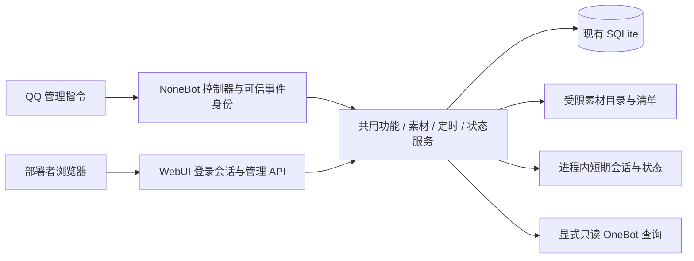

# ALING v0.4 内置管理面板设计

日期：2026-10-11（Asia/Shanghai）。开发者：Jack233_。所属品牌：onlyryx。

状态：设计草案，供文档评审；尚未实施。目标版本 v0.4，当前代码仍为 v0.3.1。
设计基线：`main` 合并提交 `c3f9f086265d55a80a5aeaa08a908a66e4a5a9b0`。

## 1. 目的与已经确定的方向

阿零需要一个方便部署者日常管理的入口：不用反复查命令、编辑素材清单或翻阅容器日志，
即可判断运行情况、调整功能、维护表情包和定时消息。面板随开源项目一起交付，兼顾维护者自身
使用和其他部署者的使用体验。

已确定：内置、可选的 WebUI；同一仓库、同一 bot 进程；保留 QQ 管理指令；面板和 QQ 指令
共用服务、权限规则及持久化数据。NapCat WebUI 继续负责 QQ 登录与协议接入。

已确定的视觉方向：参考用户提供的 NapCat Next WebUI 界面，采用相近的导航、圆角卡片与
操作组织方式；主色调整为类似 DeepSeek 的蓝色，界面品牌为“阿零管理面板 / ALING Panel”。

本稿采用的访问假设：默认仅本机可访问；面板适配手机尺寸，但不自动开放局域网或公网。
部署者可明确配置 HTTPS 反向代理和访问地址，用于远程访问。远程首次部署向导不属于首版。

成功标准：部署者能看到“是否生效、为什么未生效”，安全地完成上述管理操作；同一操作从 QQ
和面板发起时产生一致结果；已有配置、数据卷和隐私规则继续有效。

## 2. 现状与需要补齐的边界

根据实际代码核对：

| 现有能力 | 代码位置 | 对面板的影响 |
| --- | --- | --- |
| FastAPI 与 bot 生命周期、`/health`、`/ready` | `src/aling/app.py` | 在现有应用挂载面板，无须第二个服务 |
| 全局/群级功能开关、群允许列表 | `services/features.py`、`core/permissions.py` | 复用授权和状态判断，不能绕过服务直接写数据库 |
| SQLite 全局/群设置、定时计划与发送声明 | `core/storage.py` | 保持现有表与数据路径；增加必要的列表查询 |
| 记忆确认和停用后的会话清理 | `plugins/commands.py` | 目前部分逻辑在 QQ 控制器中，应移入共享服务 |
| 本地清单读取和图片校验 | `services/memes.py` | 增加受限写入能力，继续兼容现有清单 |
| 定时计划的权限、锁和防重复发送 | `services/scheduler.py` | 由面板调用同一服务，不另起调度器 |
| OneBot 连接与显式 QQ 状态查询 | `services/status.py` | 分别展示进程、协议连接和 QQ 状态 |
| `/app/memes` 的只读挂载 | `compose.yaml` | 上传需要明确启用可写挂载，不能只增加前端按钮 |

v0.3.1 的 AI/web/meme/memory 全局开关默认关闭，超级用户直接通过运行时命令调整。
旧 `AI_ENABLED`、`WEB_ENABLED`、`MEME_ENABLED`、`AI_MEMORY_ENABLED` 不再构成功能上限。
`AI_TOOLS_ENABLED`、`PROACTIVE_ENABLED` 仍是部署配置。

## 3. 首版范围

### 3.1 状态总览

- 展示版本、进程启动时间、OneBot 连接、最近事件时间及最近脱敏诊断。
- QQ 在线状态来自有超时的 `get_status` 查询，提供“刷新状态”操作并显示查询时间。
- 未连接、查询失败或缓存过期时显示“未知/未连接”，不沿用旧的“在线”结论。
- 较长时间未收事件只能作为排查线索；不自动断定风控、账号封禁或登录失效。
- 本机访问时提供 NapCat WebUI 入口链接；远程访问时提示使用实际部署的 NapCat 入口，
  不把浏览器所在设备的 localhost 当成服务器。不读取其登录密钥，不执行登录或重登录。
- 不提供聊天记录、原始容器日志、系统终端或任意 OneBot 接口调试。

### 3.2 功能与群配置

- 管理 AI、网页、本地表情包、短期记忆的全局及群级开关。
- 分别展示“全局设置”“本群设置”“实际生效状态”和阻止生效的原因。
- AI 缺少凭据、全局 AI 关闭、群级 AI 关闭等依赖必须显示明确中文解释。
- 全局开关不受旧 `.env` 功能许可约束；开启 AI/记忆仍检查实际模型凭据。
- 非允许群显示为不可管理，后端同样拒绝写入；面板不修改 `ALLOWED_GROUPS`。
- 从已保存设置、显式允许群与可用的 QQ 群列表构造管理列表；群名只作显示。
- 离线时仍可管理已有且在允许范围内的设置，群名未知时显示群号。
- QQ 群列表由部署者显式刷新，只读查询并缓存于内存；读取失败不删除已有设置。
- 首版读取模型名、配置完整性、AI 工具开关与限频等安全摘要；不编辑模型凭据或人格。

短期记忆必须走独立确认流程。打开开关时先显示暂存范围、TTL、轮数、模型发送与清除方式，
部署者明确确认后才能启用。普通功能更新接口不能通过 `memory=true` 跳过确认。
关闭某群 AI/记忆清理该群会话；全局关闭则清理全部会话，并阻止旧请求恢复已清除数据。

### 3.3 表情包素材

- 列表、预览、按标签查找、单文件上传、编辑描述/标签与移除清单条目。
- 展示来源与许可等可选说明，鼓励保存素材的再分发依据；旧清单没有这些字段时照常读取。
- 上传后先产生一个描述为“未整理素材”、标签为空的有效条目，再在界面编辑元信息。
  若元信息保存失败，已上传素材仍可见，用户可继续整理。
- 上传直接使用受限的二进制请求，避免为单文件上传引入前端构建链或额外 multipart 解析依赖。
- 沿用 PNG、JPEG、静态 WebP/静态 GIF、单张 5 MB、1200 万像素、单帧、清单 1 MB/
  5000 条、描述 200 字、32 个标签且每个标签最多 80 字的现有校验。
- 移除操作明确提示“从素材清单移除，原文件保留”；首版不自动清理磁盘原文件。
- 素材目录只读时支持查看和预览，写入控件显示不可用原因，后端拒绝所有写入。
- 损坏的旧清单显示修复提示，不自动创建空清单覆盖旧数据。

### 3.4 定时消息

- 查看、创建、编辑和删除现有每日定时计划；保持每群一个计划、1–500 字文本的约束。
- 调整本群主动发言开关；展示时区、安静时段、全局部署开关及限频条件。
- `PROACTIVE_ENABLED=false` 时明确显示“计划已保存，主动发言尚未启用”，不暗中改部署配置。
- 展示已有的最后尝试日期；没有投递结果证据时不显示“发送成功”。
- 继续沿用现有防重复发送声明；编辑/删除重建计划不能绕过当日发送限制。
- 首版不增加“立即群发”“测试发送”或自动补发入口。

### 3.5 首版之外

模型供应商与密钥编辑、人格编辑、安装向导、普通群管理员登录、多部署者账号、跨实例管理、
插件安装/市场、任意插件表单生成、远程自动部署、进程重启、QQ 登录、风控解除、聊天记录浏览、
群管理处罚操作均不进入 v0.4 首版。不为这些功能提前创建空接口或数据库表。

## 4. 页面与交互

### 4.1 视觉方向与布局

整体感觉为熟悉、轻快的机器人管理面板。布局参考用户此前提供的 NapCat Next WebUI 截图：
左侧导航、顶部标题/面包屑、右侧卡片内容区，选中导航有明显的圆角高亮，常用操作容易找到。
配色参考 [DeepSeek 官网](https://www.deepseek.com/)，导航与卡片组织可对照
[NapCat WebUI 文档](https://napneko.github.io/config/starter.shell)。下表色值是 ALING 的拟定主题值。

- 桌面侧栏约 232 px，顶部内容栏约 64 px；内容区按页面宽度留出 24–32 px 边距。
- 侧栏顶部显示阿零名称与 ALING 标识，依次放置四个首版入口；底部放主题切换与退出登录。
- 卡片使用 12–16 px 圆角、细边框与轻阴影，页面背景采用很浅的灰蓝，主体卡片为白色。
- 蓝色用于主要按钮、选中导航、焦点、链接与关键标识；大面积背景保持清淡，文字以深灰为主。
- 顶栏显示当前页面标题、必要的层级导航及数据刷新状态；保存操作优先放在对应卡片内。
- 保留 ALING 自身名称与品牌，不使用 NapCat/DeepSeek 的 Logo、吉祥物或未经授权的图片素材。
  品牌署名为 Jack233_ / onlyryx；首版可用简洁文字标识，无须先设计新吉祥物。

### 4.2 配色与组件规范

| 用途 | 拟定颜色 | 使用方式 |
| --- | --- | --- |
| 品牌蓝 | `#4D6BFE` | 品牌标识、装饰与主要高亮 |
| 主按钮蓝 | `#405DE6` | 搭配白色普通字号按钮文字 |
| 蓝色文字 | `#3451D1` | 链接、选中导航文字 |
| 选中浅蓝 | `#EAF0FF` | 选中导航和轻量提示背景 |
| 页面背景 | `#F6F8FC` | 浅色主题的内容底色 |
| 卡片背景 / 边框 | `#FFFFFF` / `#E2E8F0` | 内容分区 |
| 正文 / 次要文字 | `#172033` / `#56657A` | 标题、表单与说明 |
| 成功 / 警告 / 错误 | `#16804A` / `#996000` / `#C43D4B` | 状态文字与图标，同时附文字说明 |
| 深色背景 / 卡片 | `#0B1220` / `#131A2B` | 深色主题的背景与内容区 |
| 深色强调 / 次要文字 | `#8295FF` / `#A6B3CD` | 深色主题的高亮文字与说明 |

普通文字与实际背景对比度目标至少 4.5:1。候选品牌蓝配白字约 4.33:1，因此普通按钮使用
稍深的主按钮蓝，白字对比度约 5.35:1。深色主题的实心按钮同样使用主按钮蓝，浅亮蓝用于
深色底上的文字和边框；正文使用浅色高对比文本。实现时验证所有实际组件与状态的配色组合。

颜色通过共用 CSS 变量定义，避免在各页面散落不同蓝色。默认浅色主题，提供浅色/深色切换；
仅主题偏好可以保存在浏览器本地，登录密钥、会话与业务敏感信息不能随之写入本地存储。

按钮、输入框、下拉框、开关、提示和弹窗使用统一圆角、间距和焦点样式。
输入控件高度约 40–44 px；图标保持简洁一致；动画只用于短暂反馈，遵循减少动态效果偏好。
状态不只用颜色区分，必须同时显示“开启/关闭/未知/受限”等文字。

### 4.3 各页面呈现

- **登录页**：居中的浅色卡片、ALING 文字标识、独立登录密钥输入和蓝色登录按钮。
- **概览**：连接与运行状态卡片，下面显示最近事件和脱敏诊断；只展示实际可获取的数据，
  首版不增加 CPU 图表、服务器终端等未纳入范围的控件。
- **群与功能**：全局开关卡片与群选择区；每项同时显示保存状态、实际状态及依赖说明。
- **表情包**：缩略图网格、搜索/标签筛选、单文件上传区域与元信息编辑；浅蓝色标示可交互区域。
- **定时消息**：按群排列的计划卡片和编辑表单，时区、安静时段与未启用原因邻近显示。

宽度不足 768 px 时侧栏折叠为抽屉、卡片转为单列；素材网格按可用宽度调整列数。
布局和间距延续 NapCat 的易用感，页面信息与按钮名称围绕阿零的实际管理操作组织。

### 4.4 操作反馈与可访问性

登录页名称为“阿零管理面板”，输入项名称为“阿零面板登录密钥”，说明它与 NapCat WebUI
密钥、OneBot Token、模型 API Key 分别独立。首版为单部署者身份，不要求在登录页面填写 QQ 账号密码。

登录后提供“概览”“群与功能”“表情包”“定时消息”四个导航入口。
窄屏使用折叠导航；表单具有可见标签、键盘操作、焦点状态与非纯颜色的错误提示。

开关提交期间防止重复点击；成功后以服务端返回的实际状态更新界面。
失败时保留用户输入，说明权限、依赖、只读目录或保存失败等具体类别。
危险操作使用针对该操作的确认，例如移除素材和启用短期记忆；不弹出泛化的重复确认。

浏览器每 15 秒刷新轻量运行状态，只在页面可见时进行；不持续拉取原始日志或调用 QQ API。
QQ 状态查询缓存 30 秒，重复刷新共用结果，查询超时不影响已保存配置的管理。

## 5. 架构与数据流



采用静态 HTML/CSS 与原生 JavaScript，随 Python 包提供，不使用 CDN，不要求 Node.js 或独立
前端服务器。现有 FastAPI 承载 `/webui/`、静态资源及 `/api/admin/`，管理接口返回有限的 JSON
视图。普通页面是轻量壳，业务数据必须通过已鉴权的 API 获取。

建议新增 `src/aling/webui/`，包含挂载入口、鉴权、路由及静态资源；业务仍留在现有服务层。
`app.py` 只按配置挂载入口，不堆积管理业务。打包配置需包含静态资源，验证 wheel、sdist 与 Docker
中的资源完整性。单个 bot 进程维护一个 Runtime，不引入多 worker 或第二个配置写入进程。

实际需要的共享改动：

1. 将功能停用后的会话清理、短期记忆确认移入现有功能服务，共用后再简化 QQ 控制器。
2. 为存储增加只读列表查询；已有开关写入继续通过 FeatureService 更新数据库及内存状态。
3. 为 LocalMemeProvider 增加受限目录写入，抽取图片字节校验供读取和上传共用。
4. 状态服务提供有限的管理视图；近期诊断只保留固定类别、时间和异常类型。

不为每个服务再包一层只有转发作用的管理服务。浏览器和 QQ 指令都是业务服务的调用者。

## 6. 登录、权限与访问边界

以下为拟新增配置，当前 v0.3.1 尚不支持这些设置：

```dotenv
WEBUI_ENABLED=false
WEBUI_ADMIN_TOKEN=
WEBUI_OWNER_ID=
WEBUI_ORIGIN=http://127.0.0.1:8080
```

- 默认不挂载管理路由。明确启用时必须提供足够随机的独立登录密钥，至少使用 32 个随机字节
  生成；没有可用密钥或合法身份时配置校验失败，错误信息不能包含敏感值。
  文档提供 `secrets.token_urlsafe(32)` 生成方式；启动拒绝不足 43 个 URL 安全字符或含空白的密钥，
  格式校验不能证明随机性，也不替代部署者使用生成器。
- `WEBUI_OWNER_ID` 必须是配置于 `SUPERUSERS` 中的 QQ ID。部署者通过面板密钥登录后，
  后端将会话映射到这个固定身份；密钥本身不提供 QQ 官方账号认证。
- API 不接受浏览器声明的操作者 ID、管理员角色或超级用户身份。群权限上下文由后端构造，
  QQ 角色字段按普通成员处理，以真实配置的超级用户权限授权，继续检查群允许列表。
- 更新 PermissionContext 的来源说明，以覆盖可信 OneBot 事件和已鉴权的部署者会话；
  群处罚仍只接受原有 QQ 事件流程，面板不提供群处罚接口。
- 登录密钥仅通过受限 POST 请求提交，以常量时间比较校验；不放 URL、日志或浏览器本地存储。
- 成功登录后创建随机、不透明的服务器端会话，最长有效 8 小时，最多 8 个并存会话，
  超限时撤销最早会话。退出登录撤销当前会话，进程重启或重启更换密钥撤销全部旧会话。
- Cookie 设置 HttpOnly、SameSite=Strict；配置 HTTPS 访问地址时必须设置 Secure。
- 管理写操作检查与会话绑定的 CSRF Token，以及精确匹配 WEBUI_ORIGIN 的 Origin/Host。
  登录同样验证来源；不启用任意跨域，不使用来源通配符，不默认信任转发头。
- 登录失败按连接来源限频：每分钟 5 次；同时限制全局每分钟 20 次，返回统一认证失败反馈。
  登录请求体最大 1 KiB，敏感请求在记录前丢弃正文。
- 管理访问校验仅作用于 WebUI/管理 API，不改变 `/onebot/v11/ws` 的协议鉴权与 Docker 内部访问。
- 远程入口由部署者显式配置 HTTPS 反向代理、保持正确 Host 并设置精确外部 Origin；
  默认 Compose 的宿主机端口仍仅绑定 127.0.0.1，不自动开放端口或建立公网隧道。
- 页面采用同源静态资源、安全文本渲染、限制 CSP、禁止嵌入、MIME 防嗅探；群名、素材描述、
  定时文本和诊断都不能作为 HTML 或可执行脚本插入。

短期记忆确认由共享服务维护一次性、60 秒有效的确认记录；记录绑定可信操作者、群及来源，
WebUI 还绑定当前登录会话。确认前再次核对权限与全局依赖，过期或重复使用时拒绝。
记录不写数据库，数量上限 1000，过期清理；停用相关功能同时撤销未完成确认。

## 7. 管理接口契约

所有管理接口均位于 `/api/admin/`，登录接口之外必须鉴权。请求模型拒绝未声明字段。
功能、素材与计划均使用固定操作集合，不能传入方法名、系统命令、任意文件路径或 OneBot action。
认证、来源与 CSRF 校验在业务请求体解析前进行。除图片流和更小的登录请求外，管理请求体上限
为 16 KiB；列表每页最多 100 条。QQ 群列表内存快照最多 1000 条，截断时明确标识结果不完整。

| 接口类别 | 首版操作 | 约束 |
| --- | --- | --- |
| 登录会话 | 登录、查看当前会话、退出 | 独立密钥、会话与 CSRF 校验 |
| 运行概览 | 读取概要、显式刷新 QQ 状态 | 有限视图；OneBot 请求总时限 10 秒 |
| 群与功能 | 读取群列表、更新单项全局/群开关 | 可信部署者身份、允许群、依赖校验 |
| 短期记忆 | 获取说明与一次性确认、确认启用 | 通用开关接口不能直接开启群记忆 |
| 素材 | 列表、资源 ID 预览、上传、编辑元信息、移除索引 | 无路径参数、大小与目录校验 |
| 定时计划 | 读取、保存、删除、本群主动开关 | 使用现有调度服务，不立即发 QQ 消息 |

功能响应区分保存的全局状态、群状态、最终状态，并返回稳定的阻止原因：
`global_off`、`group_off`、`ai_credentials_missing`、`global_ai_off`、`group_ai_off`、
`scope_restricted`。页面将它们映射为中文说明，不依赖异常原文拼接。

未认证返回 401；无权限返回 403；不存在的资源返回 404；状态依赖/只读目录冲突返回 409；
超限返回 413；输入校验失败返回 422；限频返回 429。响应不包含调用栈或第三方异常正文。
关闭面板时对应路径返回 404。

## 8. 保存一致性、目录写入与隐私

### 8.1 配置与并发

环境配置继续在启动时读取。首版不通过 API 修改 `.env`，只输出明确白名单的配置摘要，不能
直接序列化整个 Settings；密钥只显示“已配置/未配置”，不回显原文。

运行时开关和计划沿用 SQLite。功能变更与会话清理由共享服务在单进程内串行协调；先保存成功，
再发布实际状态。成功停用返回前必须完成对应缓存清除与旧请求写入失效处理。
并发管理按最后一次成功操作生效，客户端显示服务端状态；保存失败不得显示成功或改掉原状态。
日程继续使用现有服务锁及持久发送声明。首版不要求新增数据库表。

### 8.2 素材写入

图片验证发生在进入可检索清单之前。请求流超过 5 MB 时立即停止读取；不能只信任
Content-Length。同时最多 2 个上传，每部署者每 10 分钟最多 30 次上传，失败也计入限频。
服务端使用内容哈希与已验证格式生成文件名，忽略客户端文件名作为路径；拒绝路径穿越、符号链接
写入及目录外文件。预览通过资源 ID 返回已验证图片字节，不暴露整目录或原始路径。

素材修改在进程内锁中执行，使用同目录临时文件和原子替换发布 `manifest.json`，保留一份有限的
上一版清单备份。图片先写入成功，再发布引用；失败时保留原清单，并只清理本次创建且尚未引用的
文件。读取者只能看到完整旧清单或完整新清单。新文件去重时不得删除既有文件。
编辑时保留未修改条目及旧清单的未知字段；客户端不能修改资源 ID 或文件路径。
来源/许可说明各限 500 字，仅作为纯文本展示，不自动访问其中的链接。

面板管理的上传图片总容量上限 200 MB，包含已移出清单但保留的上传文件；原有素材可继续只读查看。
达到上限后停止新增，提示部署者离线整理文件。容量核对与发布在同一写锁下，避免并发突破上限。
图片、元信息与备份不进入 SQLite，也不进 Git。

### 8.3 诊断与记忆

最近诊断使用最多 100 条、最长保留 24 小时的进程内记录，只存时间、组件、固定事件类别和
异常类型。不截取框架/第三方原始日志，不保存消息正文、模型提示、响应、URL、密钥或上传内容。

操作记录仅使用固定事件类别、结果与变更字段名；不记录定时文本、素材描述、请求体或认证信息。
短期 AI 会话保持现有进程内 TTL 与容量限制，面板不提供查看会话正文的接口。

## 9. 交付与兼容部署

WebUI 静态资源包含在 wheel/sdist/Docker 镜像中。原 CLI、QQ 指令、`/health`、`/ready` 和
OneBot 路径继续兼容；面板关闭时原部署工作方式不受影响。

保留 SQLite 默认路径 `data/ryxbot.db`、Compose 项目名 `ryxbot`、`bot-data`、
`napcat-qq`、`napcat-config` 卷及原素材挂载源，升级不能创建一个空数据库替代旧库。

原 `compose.yaml` 保持素材只读挂载。计划新增可选 `compose.webui.yaml`，仅覆盖 bot 的
WebUI 启用项以及同一 `/app/memes` 挂载目标的可写模式，不新增服务或放开根文件系统。
部署说明提供合并配置的检查方法，确认保留全部现有数据卷与 127.0.0.1 端口绑定。

可写素材目录必须允许现有非 root bot 用户写入，诊断应识别权限不足；不通过 root 运行、
`chmod 777` 或挂载宿主机广泛目录解决。没有正确写权限时面板进入素材只读模式。

既有 `.env` 的新增面板设置由部署者自行配置，独立密钥不能采用已有 OneBot/NapCat/模型密钥。
本设计阶段不读取真实凭据，不修改真实目录或数据库，不重启 bot/NapCat，不推送或部署。

## 10. 实施顺序与验收

这是设计层面的交付顺序；具体实施任务在文档评审后另行拆解。

1. **共用行为与入口**：收拢记忆确认/停用清理，建立可选面板挂载、登录鉴权与静态壳。
2. **状态和功能**：完成四类状态说明、群列表与单项开关；验证 QQ/面板操作一致。
3. **素材管理**：实现受限上传、预览、清单原子编辑与只读模式；验证可写部署配置。
4. **定时管理与交付**：复用调度服务、完善响应式界面、诊断、包资源和部署说明。

| 验收项 | 必须提供的证据 |
| --- | --- |
| 面板可选与身份鉴权 | 关闭返回 404；未登录无数据权限；错误身份拒绝；退出/过期/重启撤销会话 |
| 登录与浏览器边界 | 登录限频、CSRF、Origin/Host、Cookie、XSS 文本渲染；不能影响 OneBot 接入 |
| 功能操作一致 | QQ 改动在面板可见、面板改动在 QQ 生效；默认关闭与 SQLite 重启持久化 |
| 权限与短期记忆 | 伪造操作者/角色/允许群失败；绕过/重复/过期确认失败；停用后的旧请求不能恢复缓存 |
| 状态准确 | 进程存活、WS 连接、QQ 状态分别模拟；失败显示未知，不能自动断定风控 |
| 素材安全与一致性 | 超限/损坏/动画/路径/符号链接拒绝；并发与中断不破坏清单；只读时不能写入 |
| 计划与隐私 | 不绕过开关、安静时段和每日声明；明确计划文本之外不增加聊天存储；响应和日志无敏感值 |
| 打包与部署 | Python 包构建、静态资源独立安装、Compose 合并验证、Docker 构建与隔离运行 |
| 手工体验 | NapCat 风格导航/卡片与 ALING 蓝色主题；浅色/深色、桌面/窄屏、键盘、文字对比度、错误提示及四页操作验收 |

自动测试使用临时配置/目录/数据库、虚构凭据及模拟 OneBot，不连接真实 QQ 或模型供应商。
实现后运行 pytest、Ruff、锁文件与差异检查、包构建、Compose 配置和 Docker 构建检查。
真实实例更新及 QQ 验收作为随后明确的提交部署任务处理。

## 11. 后续版本的边界

首版验收后再评估模型/人格编辑和插件配置页面。届时先确定配置优先级、持久化与密钥保存规则，
再增加界面；不能简单把整个 `.env` 变成可编辑文本框。普通群管理员账号及远程多用户权限需要
单独的身份设计。插件市场、跨实例管理和自动部署不作为已有面板的附带功能。

相关当前文档：[README](../../../README.md)、[架构说明](../../architecture.md)、
[素材说明](../../memes/README.md)、[Compose 配置](../../../compose.yaml)。
