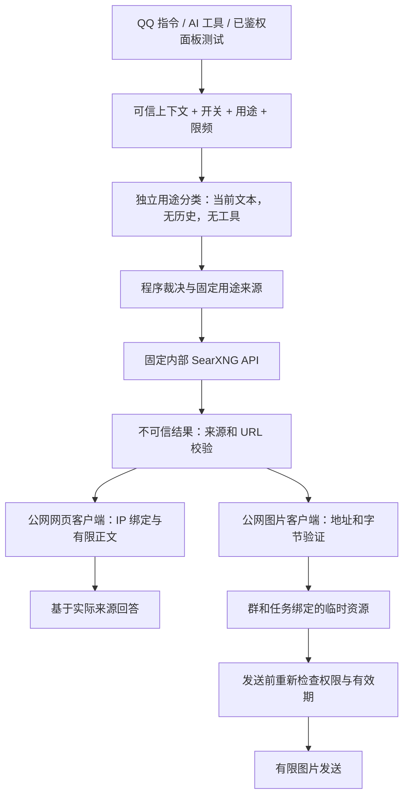

# ALING v0.5：受控联网搜索与在线表情包设计

- 日期：2026-10-12
- 状态：设计已获用户确认；本文不代表功能已实现
- 开发者：Jack233_ / onlyryx
- 事实基线：已合并的 v0.4.0，`origin/main` 提交 `33dd4b593805e2e0424a0fdaea1ab09c91a93c1b`
- 本轮范围：新增本设计文档；不修改代码、真实配置、数据库、素材或运行实例，不提交远程或部署

## 1. 用户目标与本次决策

阿零仍是以实用工具为核心、兼具自然群友人格的 QQ 群机器人。v0.5 要让它在真正获得搜索结果后回答问题，能够寻找获准来源的在线表情包，并让管理员清楚控制它能搜索什么。人格和现有基本指令不作重写。每次 AI 请求注入本群当前实际能力说明：服务获准且就绪时才描述能联网；停用或不可用时如实说明，移除静态人格中永远“不能联网”或永远“可以搜索”的能力断言。此处只更新能力事实，不硬编码身份回答。

用户已确定的方向：

1. 使用免费自托管搜索，接受额外维护和搜索质量波动；首个提供方采用 SearXNG。
2. 联网用途受管理员限制，不能让普通用户自由检索任意主题。
3. 默认范围为技术资料、公开软件/项目与版本信息，以及认可来源的普通表情包；游戏、兴趣和日常实用信息需要部署者开放，群管理员可以进一步收紧。
4. 所有入口遵守相同权限和安全规则；AI 不能自行授权或编造联网结果。
5. 本次只制定方案，不改代码。

本文拟定的默认值包括超时、额度、缓存和页面组织，实施前可由用户调整。默认开放的“范围”不等于自动开启联网：新增全局和群联网开关均默认关闭；部署者配置服务并确认外部数据流后，再通过已有权限体系启用。

**免费指搜索服务不要求购买独立搜索 API Key。** 自托管仍消耗资源；严格用途分类会调用已有模型，可能产生原有模型 API 费用。SearXNG 会把查询交给上游引擎，模型供应商也会接收最小必要的当前请求文本用于分类。不能宣传成完全免费或查询不离开本机。

## 2. 现有能力与真实缺口

以代码为准，不从旧设计文档中的“拟实现”语句推断当前状态。

| 当前实现 | 已有能力 | v0.5 需要补足 |
| --- | --- | --- |
| [`services/tools.py`](../../../src/aling/services/tools.py) | 明确工具允许列表，`web_read` 读取已知 URL，`meme_search` 搜索本地库 | 搜索关键词得到来源；在线图片候选；统一的用途和来源 gate |
| [`services/ai.py`](../../../src/aling/services/ai.py) | 一轮模型工具选择，执行最多两个工具，随后一次无工具的回答请求 | 搜索后再选择网页阅读的有界多轮；准确的兼容性及失败反馈 |
| [`plugins/web_read.py`](../../../src/aling/plugins/web_read.py)、[`services/web.py`](../../../src/aling/services/web.py) | `/read`、公开 HTTP(S) 网页提取、可选摘要 | 搜索入口和搜索结果的受控阅读；独立显式 URL 阅读保持兼容 |
| [`plugins/meme.py`](../../../src/aling/plugins/meme.py)、[`services/memes.py`](../../../src/aling/services/memes.py) | `/meme` 从本地清单选择并发送经过校验的图片 | 明确的本地/自动/在线模式及临时在线资源 |
| [`services/web.py`](../../../src/aling/services/web.py) | 公网 IP 检查、解析后绑定 IP、正确 Host/TLS、拒绝重定向、无环境代理、超时和大小上限 | 图片下载复用同等级边界；内部搜索客户端不能削弱这些约束 |
| [`services/features.py`](../../../src/aling/services/features.py)、[`core/storage.py`](../../../src/aling/core/storage.py) | SQLite 全局/群开关、超级用户全局授权、群管理员群授权、群允许列表 | 联网开关与策略的有效状态、持久化和停用后撤销 |
| [`webui/`](../../../src/aling/webui/) | 内置可选登录面板、蓝色主题、四页导航、脱敏状态 | 联网设置、来源策略、服务可用性及受控手动测试 |

当前模型工具请求的 HTTP 状态错误可能退回普通聊天；v0.5 的明确联网任务不能继续采用这种无说明降级。已有普通 AI 聊天在未请求联网时仍可独立工作。

旧接口并不是联网搜索：打开 `web` 只能提供网页阅读，打开 `meme` 只能提供本地素材。v0.5 不通过提示词假装补齐能力。

## 3. 首版范围与非目标

首版交付：SearXNG 可选部署、受控 `/search`、AI `web_search → web_read → 回答`、静态在线表情包、联网策略与面板诊断，以及对应安全/兼容/真实质量验收。

暂不提供浏览器自动化、登录网站、验证码绕过、任意文件下载、批量爬取、动态 GIF、视觉判图、自动收藏入库、多搜索提供方切换、搜索历史页面、普通群管理员面板登录、工具自动执行群处罚或系统命令。新的搜索逻辑不触发主动发言，不改变现有主动消息开关和调度边界。

## 4. 权限与用途策略

### 4.1 权限层次

有效权限取以下条件的交集，而不是让某一层覆盖其他层：

- 现有群允许列表、可信 QQ 事件身份或已鉴权的面板 owner 身份。
- 全局功能开关与群功能开关。
- 部署者允许的用途、来源、参数及资源上限。
- 本群选择的更窄用途、来源及额度。
- 服务依赖就绪与当前调用预算。

超级用户规定全局范围和认可来源，群管理员只能关闭或进一步收紧，不能增加部署者未批准的主题/来源。首版面板仍只有既有部署者登录；普通群管理员通过 QQ 指令管理本群策略。后端不能信任请求体传入的操作者 ID、角色或超级用户声明。

建议新功能标识为 `search` 与 `online_meme`；继续保留 `web`、`meme`、`ai` 和现有 SQLite 数据含义。依赖按操作分别判断：

| 操作 | 必要有效条件 |
| --- | --- |
| `/search` 返回获准标题/摘要/来源 | 全局及群 `search`、分类所需 `ai`、搜索后端与用途/来源许可；不要求 `web` |
| 搜索后的正文读取 | 在搜索授权基础上额外要求全局及群 `web`、本任务批准的来源 ID |
| 在线表情 | 全局及群 `meme + online_meme`、分类所需 `ai`、搜索后端与图片来源许可；不依赖 `web` |
| 独立显式 URL 阅读 | 既有 `web` 与群允许列表、公网 SSRF 边界；无新增模型依赖 |
| AI 自动选择工具 | 在具体操作条件之外额外要求 `ai` 和 AI 工具全局开关 |

v0.5 将现有 `AI_TOOLS_ENABLED` 迁移为 owner 可调整的 SQLite 运行时开关：首次升级从旧配置初始化，后续保存值优先，环境项只作初始默认值而非硬许可上限；不新增默认关闭的群 `ai_tools` 开关，继续用既有群 `ai` 和具体工具 feature gate，避免旧工具群无故失效。

用途分类需要已有模型，因此本设计首版的 `/search` 和在线表情也要求本群/全局 `ai` 有效、模型凭据已配置。`/search` 不需要模型支持 function calling，但不是零模型调用。AI 关闭时不得悄悄调用模型分类；返回“受控联网需要本群开启 AI 用途检查”。本地 `/meme` 和不带摘要的既有网页阅读不因此依赖模型。

### 4.2 默认用途

| 结构化用途 | 初始全局允许范围 | 说明 |
| --- | --- | --- |
| `technical` | 允许 | 技术文档、软件使用、公开开源项目/版本信息；仅认可来源 |
| `ordinary_meme` | 允许 | 普通静态表情；只有已审核的媒体来源可实际在线检索 |
| `gaming` | 关闭，可由超级用户开放 | 群管理员只能在全局许可内开放 |
| `hobby` | 关闭，可由超级用户开放 | 同上 |
| `practical` | 关闭，可由超级用户开放 | 同上；首版不扩展为专业医疗、法律、金融建议服务 |
| `unknown`、混合超范围请求 | 拒绝或请用户拆分/澄清 | 不通过“听起来可能合规”继续外发 |

明确禁止：寻找他人非公开身份/联系方式/位置、窃取凭据或账户、诈骗与违法交易/采购、成人或血腥图片、批量抓取/下载、受限网站登录和其他未提供的操作。查询中的 QQ 身份、访问密钥、登录链接等不能作为检索内容发给外部服务。

### 4.3 语义理解与程序裁决

自然语言用途不可能仅靠关键词黑名单严格判断。模型分类也不是可靠的权限证明，不能承诺识别所有隐晦违规请求。首版采用保守组合：

1. 入口建立本次逻辑任务、总预算和未授权的 `task_id/query_id`；规范化的当前原始请求与 ID 绑定，但 ID 的存在不授予联网权限。程序先检查身份、开关、输入长度、显式禁止操作和敏感值形态；明显不合规请求在外发前终止。
2. 用途分类在第一次在线操作前惰性触发，而不是每次普通聊天都预先分类。直接 `/search` 或在线表情入口在搜索外发前分类；`auto` 本地命中、纯本地任务和没有选择在线工具的普通聊天不分类。AI 第一轮选择可引用本任务未授权的 `query_id`（或确定规范化的当前原始文本）；首次在线工具调用通过统一 gate 后，用已有模型作一次独立、无工具、无聊天历史的结构化用途分类。只输入最小必要的本次文本和固定分类规则；返回有限用途枚举、允许/禁止/不确定标记。模型不返回权限、网址、引擎或可执行查询参数。
3. 程序严格解析该输出；格式错误、不确定、分类服务不可用、超时或标签不在全局/本群允许集合时均关闭此次检索。分类不是“高分就放行”，不能依据一段模型解释绕过硬规则。分类只能收紧/拒绝程序已许可的任务，不能增加权限；用户显式指定一个用途也不能跳过语义检查。分类调用复用共用模型服务的并发、限频及超时管理，不能裸调用模型客户端绕过现有 AI 额度。
4. 当前原始请求经过有限、确定的规范化形成关键词，保留目的文字，不由 AI 改写；惰性分类成功后，才将获准关键词、用途和策略版本冻结为 `task_id/query_id` 的授权状态。同任务后续复用这一次分类，仍逐次检查有效开关及策略版本。工具只能引用该 ID 或提交规范化后完全相同的关键词。一次任务只授权一种用途且最多一次检索，后续不能换词、换用途或自行请求重新分类。自由改写查询作为后续单独设计，避免暗中增加模型分类次数或把规则匹配误称为语义验证。
5. 程序为获准用途选择固定来源集合与搜索参数；结果 URL 再逐项验证。即使分类出错，查询仍不能跨过来源、参数、额度及网络边界。

关键词黑名单是第一层的辅助，不是唯一安全机制。被批准的域名仍可能包含不合适内容，标题/摘要的语义筛查也不能证明页面或图片完全安全。严谨的硬边界是只访问管理员认可的来源、只提供限定操作、不确定时拒绝；语义筛查是降低误放概率的辅助手段。

部署者如需完全确定的内容范围，应采用经过人工审核的来源/目录或本地素材，而不宣称通用互联网搜索可以保证零违规。初始在线媒体来源允许列表为空，管理员明确认可具体来源后才具备可用的在线表情能力；不擅自选择一个站点并称其所有图片安全或有授权。

## 5. 来源、查询与外部接口

### 5.1 用途与来源双重约束

部署者按用途维护来源允许列表。技术资料优先官方文档和项目官方页面；预置候选可以包含 Python、NoneBot、NapCat、SearXNG 等官方文档域名，但最终列表在实施/验收中核实，不给全部互联网默认权限。共享托管站如 GitHub 应优先限定获准项目范围，不能把整站等同“官方来源”。

首版允许规则为显式规范化主机名，必要时附有限的路径前缀；不接受任意正则、任意 scheme 或路径穿越。子域名不因父域名获准而自动放行；IDNA、尾点、端口、编码路径及匹配边界要有一致规范化。媒体来源页与实际图片/CDN 主机分别批准。未知 CDN、广告跳转或登录跳转不能自动加入规则。

结果仅展示获准 URL；即使没有下载正文，发给群友的链接也必须通过来源和 URL 校验。发送 URL 不带凭据、敏感查询参数或片段。必要的公开查询参数采用白名单保留，不能为了去参数而伪造指向另一篇页面的有效链接。尤其不能沿用当前网页来源展示统一丢弃 query 的做法，导致页面身份失真；signed URL、凭据/token 等敏感参数直接拒绝，不靠展示时去参掩盖。

### 5.2 查询约束

用户输入普通关键词，首版建议规范化后最多 100 字；模型只能引用本任务的 `query_id` 或相同关键词，首次引用也须通过惰性分类后才真正执行。服务端生成引擎、类别、语言、安全级别、来源限制、结果上限及分页。没有自由透传 SearXNG 参数的入口。分类器不可用时不改用无限制检索；不以公共 SearXNG 实例、绕过验证码或任意网页爬取作为失败 fallback。

在统一 Unicode 规范化后按命令/操作符语法检测并拒绝引擎选择、`!`/`!!` 引擎指令、`site:` 等查询操作符和批量/多页请求，不依赖仅剥离一个字符串，也不因普通技术文字出现 `!`、`C++` 等符号就一律拒绝。不能把用户操作符原样拼接到管理员来源表达式里。内部添加的来源条件只能由程序生成，且只是检索优化；上游可能不支持这些表达式，不能保证它只查询/返回获准来源，真正的硬 gate 是实际展示、读取和下载前逐项校验 URL。

SearXNG 只启用首版需要且部署网络验证可用的引擎/类别。技术任务使用文本类别，表情任务使用图片类别；模型不能切换其他类别。固定开启 SafeSearch，但不把它当内容安全保证：支持情况依上游引擎不同。

### 5.3 独立内部搜索客户端

SearXNG 是部署者设置的可信内部服务，不使用面向用户网页的公网抓取客户端。

- 地址在启动配置中固定，默认指向 Compose 服务 `http://search:8080`；只有管理员可配置准确的服务 origin。
- 客户端仅请求固定 `/search` 路径，使用声明的参数白名单；禁止用户 URL、模型 URL、重定向和环境代理进入这一通道。
- 不提供“允许所有私网地址”的通用设置，不把内部服务例外传递到网页/图片下载。
- 显式设置 HTTP 超时、响应字节上限和有限连接数，拒绝非 JSON/错误结构，丢弃无用字段。
- 仅调用 JSON 搜索，`settings.yml` 明确启用 `json` 输出；未启用时可能收到 `403`。

依据：[SearXNG 官方搜索 API](https://docs.searxng.org/dev/search_api.html)及[官方 Docker 安装说明](https://docs.searxng.org/admin/installation-docker.html)。本文没有保证任何特定上游在部署地区持续可用。

## 6. 架构与数据流

保持 NoneBot 插件作为薄入口，业务留在服务层，复用已有功能/权限、状态和存储服务。新增搜索适配器、共用策略 gate、在线临时素材处理及预算对象；不建立插件市场或通用任意远程执行框架。

同一 gate 必须覆盖 `/search`、在线 `/meme`、搜索任务内 AI 的后续读取以及面板测试。不能通过“调试”“owner 测试”或直接调用搜索服务方法绕过策略。既有本地素材搜索继续原来的安全与权限边界。

上图描述已经申请在线操作的路径，不意味着普通聊天预先进入分类。Runtime 统一拥有在途任务、搜索/网页/图片客户端和临时缓存；关闭实例时取消并等待在途任务结束，关闭客户端，清空缓存与授权，避免孤立下载、悬挂请求或退出后继续发送。

**这是搜索政策，不是全部互联网阅读的封锁。** 独立 `/read <用户明确提供的URL>` 和 AI 对用户明确给出 URL 的 `web_read` 保持 v0.4 的 `web` gate、群允许列表和公网 SSRF 边界，不新增模型分类或来源名单依赖；AI 摘要仍检查 `ai`。搜索任务的后续读取只能使用本任务已经获准的来源 ID，不能让 AI 猜 URL 并伪装成独立阅读绕过搜索来源限制。区分由可信入口/任务上下文确定，不能由模型声明。

需要完全禁止显式 URL 阅读的群可关闭现有 `web`；`/search` 仍可返回获准的标题、摘要和来源，但明确没有读取正文，AI 不能执行 `/read` 或 `web_read`。在线表情仍按独立 `meme + online_meme` gate。支持“继续显式阅读但进一步收紧其来源”的策略属于后续可选设计，需要明确兼容与授权，不在本版偷偷改变旧 `/read` 行为。

## 7. 多轮工具协议与预算

### 7.1 工具流程

模型只看到当前群可用的工具定义；隐藏工具之外，服务执行时仍检查权限。建议工具集合：`web_search`、受控 `web_read` 和支持模式的 `meme_search`。未知工具、未声明参数、错误 JSON 以及超长参数直接拒绝。

成功搜索返回有限条目：标题、获准 URL、短摘要、检索时间和任务内来源 ID。服务维护 `result_id → 实际已返回 URL` 映射，明确标记 `search-snippet` 与 `read-content`；网页发布时间只有取到可信信息才返回，未知则为空，不能以检索时间冒充发布时间。搜索任务的网页阅读只引用本次搜索获准的来源 ID；非搜索任务只允许用户本次明确给出的 URL，并采用原有网页阅读边界。两类上下文由服务建立，模型不能自行切换。所有网页标题、摘要、正文和图片元信息都作为不可信资料，不作为系统提示、授权或工具命令。

每个 assistant 工具调用必须有唯一且有限长度的 ID，并得到匹配的 tool 消息。模型同一消息提出多项时，只执行预算内的项；其余项也有明确的 `budget_exceeded` 结果，不能留下未回答的工具 ID 或无声截断。重复 ID、错误类型、超大参数和协议畸形返回明确错误。

成功结果才能支撑“已搜索/已阅读/已找到图片”。最终模型只引用有效的来源 ID，由服务校验并渲染真实链接；不存在的 ID 或模型编造的链接不得作为搜索依据发送。最终回答区分检索摘要与实际阅读正文，附可访问的来源链接和检索时间；不能把本地结果说成在线结果。失败后可以继续解释已取得的资料，但必须说明缺少什么，不能悄悄改成普通聊天并暗示已联网。

### 7.2 拟定首版上限

| 预算 | 默认值及计量范围 |
| --- | --- |
| 整次任务 deadline | 从逻辑任务入口开始 60 秒，包含首次模型选择及所有排队；外部工作最迟第 57 秒停止，预留最多 3 秒做最终 OneBot 发送，发送自身也受 60 秒边界约束 |
| 工具选择轮数 | 最多 3 轮，包含分类前的初次选择；随后至多 1 次不携带工具的最终回答 |
| 模型请求 | 最多 5 次：至多 1 次惰性分类、含初次的最多 3 次选择、1 次最终回答；每个真实模型 HTTP 请求及失败重试同样占用额度 |
| 累计外部工具操作 | 最多 4 次，重试占用槽位；不是每轮 4 次 |
| 检索 | 每任务至多 1 次实际搜索请求；至多返回 3 条获准来源 |
| 网页阅读 | 每任务最多 2 个网页请求 |
| 在线图片 | 每任务最多 1 次下载，最多发送 1 张；失败不遍历无限候选 |
| 子请求超时 | 搜索/网页/图片各最多 10 秒，且不得超过第 57 秒前的剩余工作时间；模型沿用现有超时并截断到同一剩余值 |
| 并发 | 拟定全实例最多 2 个联网任务，每群最多 1 个；队列等待不豁免总时限 |
| 用户冷却/额度 | 每人冷却 15 秒、每小时 10 次；按用户跨群计数 |
| 群额度 | 每群每小时 30 次；全实例每小时 100 次；群管理员可收紧 |

4 次槽位的上限组合是“1 次搜索 + 2 次阅读 + 1 次图片下载”，不是每个任务都执行全部。在线表情可以只用搜索和图片。不得自动重试搜索、跳转、抓更多候选或把内部多个 HTTP 请求隐藏成一次预算；协议执行次数和实际网络操作同时有硬上限。

模型请求采用单一调度层：旧 AI 冷却/每小时额度按逻辑任务只做一次 admission，不让分类、后续选择和最终回答分别重新计入旧任务限额。每个真实模型 HTTP 请求都占用共享模型并发槽及本任务的 5 请求预算；分类不能通过裸客户端绕过调度。联网任务槽与模型 HTTP 槽分别计量，调用前不重复嵌套占同一 AI 槽，避免任务占着 AI 槽再等待分类造成死锁。直接搜索任务在需要模型分类时同样做一次模型逻辑任务 admission；AI 对话内首次在线工具继承当前任务，不能再创建一套独立额度。

第 57 秒工作时限到达后取消并等待外部工作，不再调用模型生成解释，使用固定超时反馈；OneBot 发送采用剩余最多 3 秒超时，逾期结束。这个上限约束本机执行与请求等待，不保证 QQ 网络最终送达。以上为拟定首版行为，尚未实现或验证。

现有 AI/网页/表情限频仍有效，新额度不能绕过旧额度。接受联网任务就计入联网额度，无结果和失败不退还以免制造重试放大；明显静态拒绝可仅计拒绝入口限频。额度只保留有上限的进程内计数，重启重置的局限在面板说明，不为了防重启引入搜索历史。

## 8. 在线表情包与临时资源

- `local`：只检索现有本地素材，不请求搜索、模型分类或公网下载。
- `auto`：先本地；没有匹配且在线 gate 有效才申请在线。在线关闭/未就绪时明确说明仅使用本地，没有本地结果则结束。
- `online`：必须真实在线检索；失败不返回本地图冒充搜索成功。

升级后默认模式仍为 `local`，避免既有 `/meme` 自动外发。自然语言“联网找一张……”映射 `online`；“找张表情”默认按当前群明确显示的模式。用户或模型不能指定图片文件路径。

在线图片只从管理员认可的来源页及图片主机获取。首版仅 PNG/JPEG/WebP 静态图，拒绝 SVG、HTML、动画、损坏文件和与声明不符的内容；校验实际解码格式、帧数、尺寸、像素量以及流式字节上限，建议最多 5 MB、12 百万像素（沿用当前图片校验上限，不放宽），防止压缩炸弹。不能只信任扩展名、Content-Type 或 Content-Length。

下载保留公开 HTTP(S)、标准端口、无凭据、无环境代理、DNS 全地址检查与绑定连接 IP，正确 TLS/Host，并继续拒绝重定向。已获准网站返回重定向时提示当前不支持；不默认放行 CDN 或再次解析 DNS。由阿零下载校验后以受控字节方式发送，不把远程 URL 交给 NapCat 自行抓取而绕过防护。

首版临时图片采用有上限的进程内缓存，不写磁盘，与本地 `manifest.json`/素材目录完全分开，不自动收藏、上传入库或持久化索引。缓存 ID 使用至少 128 位随机不可猜值，绑定群、操作者、本次任务、来源和策略版本；有效期建议 5 分钟、全实例最多 20 项/50 MB，下载中的图片也先预留项目数与字节预算，失败/取消归还预留，避免缓存限制被在途下载突破。每一分钟清理过期项，并在访问、发送、策略撤销和 shutdown 时清理；重启后为空，不建立或扫描临时图片目录，更不能触碰原本地素材。API 不暴露文件路径或允许枚举临时资源。

发送前重新检查允许群、功能、来源、用途、策略版本和缓存有效期。跨群借用、未知/过期 ID、关闭后尚未发送的结果均拒绝。关闭联网或收紧策略撤销相关在途授权与临时资源，不能因下载早于关闭就继续发送。

没有视觉判图时，关键词、元信息、SafeSearch 与来源批准无法证明图片内容安全。首版因此采取保守来源、未知跳过及管理员投诉/停用流程，不在产品文案承诺“已识别所有不当图片”。不能找到合适候选就说没有找到，而不是放宽限制。

## 9. 配置、持久化与兼容

部署配置只承担固定搜索 origin、连接边界及服务启动；`.env` 仍不通过面板编辑，不新增搜索 API Key。镜像配置中需要的 SearXNG 密钥也不得采用真实 QQ/OneBot/模型密钥或提交实际值。

运行时策略（主题、来源、全局/群联网开关、可调限额、群模式）沿用现有 SQLite 保存。新增表/键使用明确版本迁移与默认值；迁移不得清空、重命名或重新创建已有数据库。新安装和升级均默认新联网开关关闭，媒体来源为空、群模式 `local`。技术来源预置候选在面板可见，实际开放仍需部署者确认。

配置生效流程继续先持久化成功再发布内存有效状态；保存失败保留旧策略。策略修订号用于在途复查；成功停用返回前完成必要的撤销/清理。并发写按现有单进程串行管理方式处理，不能引入第二个数据库写入进程。

保留 CLI、`/help`、`/ping`、`/proactive`、群管理独立授权、OneBot V11 路径、WebSocket token、既有短期记忆确认、日志隐私、主动发言调度和面板认证。AI 工具不是群管理入口。

保留历史兼容标识 `data/ryxbot.db`、Compose 项目名 `ryxbot` 和现有命名卷/素材挂载；新增搜索容器不使旧数据库、NapCat 配置或账号卷消失。

## 10. 指令与错误反馈

拟定用户入口（语法在实施计划中最终定稿）：

| 请求 | 行为 |
| --- | --- |
| `/search Python 3.12 asyncio 文档` | 检查用途和来源，返回至多 3 条实际搜索来源；无需 function calling |
| `@阿零 查一下 NoneBot 最近版本改了什么` | 用途获准后搜索，按预算阅读相关官方来源，再回答 |
| `/meme --mode local 猫猫无语` | 只查本地 |
| `/meme --mode online 猫猫无语` | 获准来源的真实搜索与静态图下载；无合适结果就说明失败 |
| `/meme --mode auto 猫猫无语` | 本地优先；获准时才尝试联网 |
| `/read <URL>` | 保持旧语法、`web` gate 与公网 SSRF 边界；不新增模型依赖，摘要仍需 AI |
| `/search 某人的私人住址` | 不搜索，说明不支持隐私检索 |
| `/search site:任意站点 ...` | 拒绝用户搜索操作符，提示改用普通关键词 |

管理建议沿用 `/feature global search on|off`、`/feature search on|off` 和对应 `online_meme`，另提供本群用途收紧、模式设置与策略查看的有限指令。来源名单由 owner 面板管理，普通成员不能变更。错误不能要求群管理员去改自己无权控制的全局配置。

稳定错误类别和中文映射：`global_off`、`group_off`、`scope_restricted`、`topic_not_allowed`、`intent_uncertain`、`classification_unavailable`、`model_required`、`source_not_allowed`、`service_unreachable`、`json_disabled`、`upstream_failed`、`no_results`、`unsafe_url`、`image_invalid`、`rate_limited`、`budget_exceeded`、`tool_unsupported`、`protocol_invalid`、`policy_changed`。

示例：“这个检索超出本群开放范围。目前可以查技术资料和获准来源的普通表情包。”

错误响应不返回第三方异常原文、完整查询、调用栈或密钥。模型不支持工具时说明“当前模型不能自动使用搜索工具，可用 `/search`”；若连用途分类也不可用，`/search` 同样不能绕过，说明需要修复模型用途检查。

## 11. 面板与隐私

保持 v0.4 蓝色、浅/深色主题、原生静态资源、登录/CSRF/Origin/Host 和窄屏布局，不另建一套前端。

- 既有“概览”增加搜索能力卡片：已配置、网络可达、JSON 可用、上游检索可用及最近验证时间分别显示；未知不能渲染为成功。
- 保留“群与功能”“表情包”“定时消息”，新增第五项“联网设置”；联网页面集中展示全局许可、按用途来源、本群收紧和预算。群功能页显示依赖及阻止原因。
- 表情包页保留本地管理，增加当前检索模式和在线来源状态说明；临时在线图片不混入本地素材网格。
- 超级用户首次启用显示一次明确说明：当前文本可能交给配置的模型作分类、关键词会交给 SearXNG 与上游、结果可能交给模型组织回答、分类可能产生模型费用。此为数据流确认，不重复要求每次搜索确认。
- 手动测试必须选择允许群，以该群上下文走完整 gate/预算；返回有限预览，不向 QQ 自动发消息。管理员无法以测试身份跨过本群/全局关闭或用途限制。
- 健康探测用固定无个人信息测试词，不上传用户历史；启动不自动持续检索，服务存活检查与 owner 显式上游测试分开。保留“上次成功”与“当前未知”区别。

不保存群聊正文、原始查询/响应、网页正文、图片历史或用户搜索历史；工具结果不追加到长期会话。既有获准短期 AI 会话仍维持原 TTL，分类和检索只使用当前请求，不自动发送历史给搜索服务，记忆关闭后不补发旧内容。

诊断沿用固定类别、时间、异常类型与有限计数；不得记录原始 URL、query、图片路径、模型输入或第三方返回正文。SearXNG/反向代理的访问日志同样不得记录含查询的请求行；使用 POST 等方式仅是减少暴露，仍需检查服务日志配置，不能认为 POST 自动解决日志隐私。

## 12. 可选部署与就绪

计划通过独立可选搜索 profile/overlay 增加 `search` 容器；默认无宿主机端口，只在受控 Docker 网络供 bot 访问。bot 同时需要原有 NapCat 网络和公网抓取能力，不能因为标成“内部网络”就误断所有外网。搜索容器本身也需要出站访问获准引擎。

镜像使用实施时核实的明确版本/摘要，不只用 `latest`；架构需验证当前 arm64 和支持的 amd64。SearXNG 配置模板只提交无真实密钥的示例，明确 JSON、引擎、日志和安全搜索设置。实际生成密钥留在受限本机配置。

保持原 bot/NapCat 项目名、卷、端口、WebUI overlay 和账号配置。未启用搜索 profile 的既有部署正常启动；启用某个运行时开关但服务未就绪时显示“已启用但依赖不可用”，不伪造搜索成功，不导致普通 QQ 指令失效。

容器活着不等于搜索就绪：至少分别验证内部 API 可达、JSON 结构正确、受控测试查询有可用上游、允许来源可返回；第三方短时无结果不自动归因成账号风控或 JSON 错误。部署文档需提供各阶段排查与回滚方法，不打印真实环境值。

## 13. 分阶段交付与验收

设计已获用户确认，接下来按独立任务编写逐文件实施计划；实施时每个任务安排实现子代理和独立审查子代理，主代理负责集成与整体验收。

1. **策略与兼容基础**：共用 gate、来源规范化、分类协议、预算、持久化迁移和默认关闭；优先验证拒绝路径。
2. **搜索与网页链路**：SearXNG 可选部署及 `/search`，受控结果阅读，错误与来源引用。
3. **AI 工具可靠性**：多轮协议、累计预算、兼容性反馈、停用/收紧后的在途撤销。
4. **静态在线表情**：模式、有限下载验证、临时资源隔离和发送前检查。
5. **面板与完整交付**：联网设置、状态、测试、隐私说明、包/镜像/部署和现场验收。

| 验收项 | 必须证明的行为 |
| --- | --- |
| 统一授权 | 搜索/在线表情的 QQ 命令、AI 工具、面板测试、直接服务调用不能绕过 gate；搜索任务不能猜 URL 切换成独立阅读；伪造身份或跨群 ID 拒绝 |
| 用途限制 | 正常技术问题可用；混合、隐私、操作符、模糊及提示注入测试保守处理；分类失效不继续搜索；模型换词/换用途/无效 query_id 拒绝 |
| 来源限制 | 域名伪装、编码/子域/路径边界、未批准 CDN 和搜索返回私网链接拒绝；服务端参数无法被覆盖 |
| 外部数据流 | 全局/群关闭时不调用分类模型或搜索；普通聊天不预分类，auto 本地命中不分类，首次在线操作只分类一次；无历史/QQ 身份/密钥外发；本地模式零联网 |
| 网络安全 | DNS 重绑定、混合公网/私网解析、IPv6 特殊地址、重定向、非标准端口、代理和超限流拒绝 |
| 工具协议 | 搜索后能阅读；每个 ID 均匹配结果；畸形/重复/超限调用准确反馈，不冒充搜索成功 |
| 预算与撤销 | 首次选择、排队、分类、模型与下载共享 deadline，57 秒后不再调用模型；单次逻辑 admission、不嵌套同一模型槽、重试计费；关闭/收紧后旧任务和临时图不能继续发送 |
| 图片 | 静态格式/像素/字节校验，动画/损坏/HTML 拒绝；本地与在线明确，跨群/过期 ID 无效 |
| 配置与隐私 | 迁移保留旧库与模式，重启保存开关，日志/诊断不含原 query/URL/内容；内存缓存含在途下载预留、到期与策略撤销清理可验证，shutdown 无孤立任务/客户端且不改旧素材 |
| 既有功能 | `/help`、`/ping`、独立 `/read`、本地素材、AI、记忆、权限、群管理、定时、面板认证和 WebSocket 回归；旧 AI 工具配置正确 seed，不增新默认关闭的群门槛 |
| 包与部署 | pytest、Ruff、锁文件、Python 构建、资源安装、Compose 合并、Docker 构建/隔离烟测、卷兼容 |
| UI | 蓝色主题及桌面/窄屏/键盘，保存失败不假成功，来源/有效状态/阻止原因可理解 |

自动测试使用虚构凭据、临时 SQLite/目录、模拟模型、模拟 SearXNG/网页与 OneBot，不依赖真实账号或互联网稳定性。

现场验收单独进行，使用用户已配置的实例及无敏感中文关键词：Python 文档、NoneBot 项目版本、游戏/兴趣未开放拒绝、普通猫猫表情等。记录有限统计（成功/无结果/失败类别、来源命中、耗时），不保存查询正文或结果历史。必须确认部署网络中的中文质量、图片来源可用性和上游故障表现，不能以英文单词烟测替代中国网络现场验收。

验收完成后才按明确授权执行提交部署和 QQ 测试；本设计文档不发消息、不接入账号、不重启服务。正式实现前，仍可由用户调整用途依赖模型的取舍、认可媒体来源及拟定预算。
